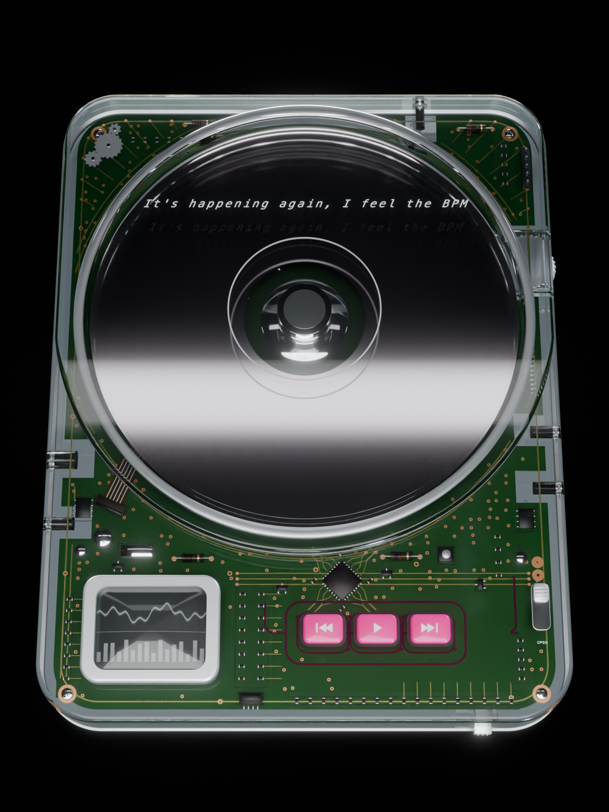
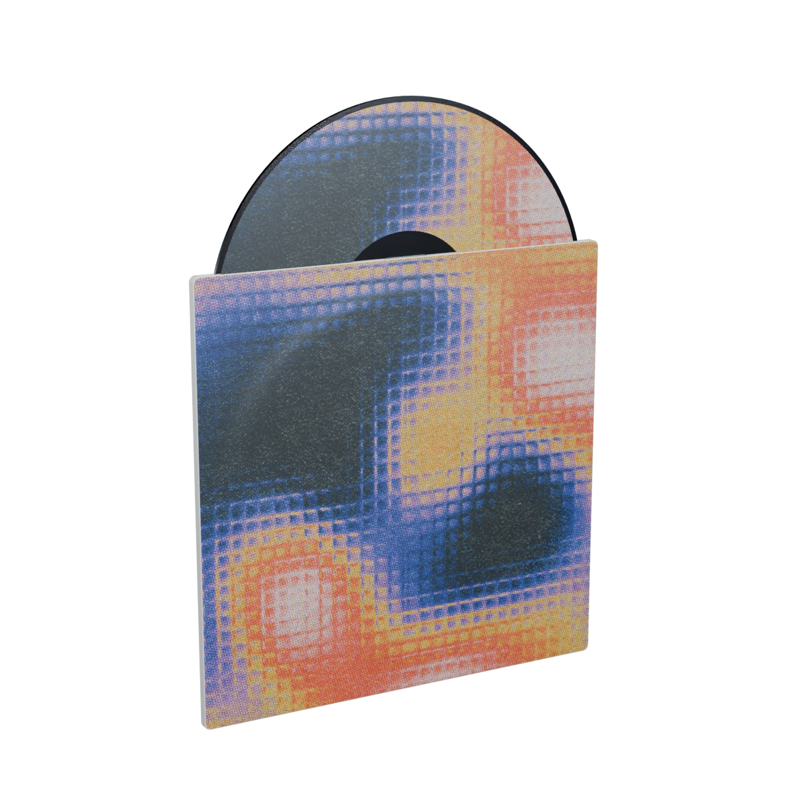

# UNTZ UNTZ

A Y2K-cyber CD player for the web. This repo has two parts:

- **The 3D models** (repo root): a portable CD player and an album sleeve, modeled in Blender 5.3.
- **The web app** (`web/`): Vite, React and three.js. Pick a disc from the crate and watch it fly into the player. See [web/README.md](web/README.md).



## Run the web app

```bash
cd web
npm install
npm run dev
```

## Blender CD player

A portable CD player: a clear glass body with a visible circuit board, a small CRT screen and hot pink keys.

## Files

| File | What it is |
| --- | --- |
| `cd_player.blend` | Source scene, including the camera, studio lights and bloom setup |
| `cd_player.glb` | Web/realtime export (glass, clear coat, glowing CRT, part names) |
| `cd_player.obj` + `cd_player.mtl` + `textures/` | OBJ export. Glass is approximated with transparency |
| `renders/` | Hero renders (`cd_player_hero_teal.png` is an earlier design) |
| `versions/cd_player_v1_teal.blend` | Earlier teal Y2K version |
| `album_sleeve.blend` + `album_sleeve.glb` | Vinyl-style album sleeve at CD size, the template for every album in the crate |
| `scripts/build_album_sleeve.py` | Rebuilds the sleeve files (add `-- --preview` to render `renders/album_sleeve_preview.png`) |

## Model

- **Size:** 140 × 180 × 26 mm, real scale in meters
- **Parts:** body, lid, disc, spindle, deck ring, CRT display, three keys (prev, play/stop, next), OPEN slider, volume wheel, five labelled sockets, plus a detailed circuit board and mechanism inside
- **Editable text:** the lid label (`Text_Label`), socket labels, board labels and chip markings are Blender text objects

## Using it on the web

Every part exports as its own named node in the GLB, for example `Disc`, `Spindle`, `Lid`, `Button_PlayStop`, `Button_Open` and `CRT_Screen`.

- The GLB is Y-up, so the disc spins around **Y** in three.js.
- `Lid` pivots on its back hinge and opens with a negative rotation around X.
- `CRT_Screen` has UVs, so its texture can be swapped for a live visualizer.
- `Disc` has no UV map yet. Add one before applying album art.
- Use an environment map for the chrome and glass, and a bloom pass for the glow.

## Album sleeve



One sleeve is the template for every album: clone `album_sleeve.glb` per album and put the album art on it.

- **Size:** 130 × 130 × 3 mm, shaped like a vinyl jacket and sized for a 120 mm CD. It's open along the top edge.
- **Parts:** `AlbumSleeve` (root), `Sleeve` (card jacket), `Cover`, `Back_Cover`, `Disc` and `Disc_Label` (a child of `Disc`).
- **Art:** `Cover`, `Back_Cover` and `Disc_Label` have UVs that fill the art square, so a square album image drops straight in. Set `texture.flipY = false`, as for any glTF texture.
- **Disc:** it rests inside the sleeve and slides out along **+Y** in three.js. Its `userData` has `peek_distance` (0.05) and `out_distance` (0.13).
- **Ring wear:** the cover bulges slightly over the disc, so a moving light picks up a soft ring.

```bash
/Applications/Blender.app/Contents/MacOS/Blender -b --factory-startup --python scripts/build_album_sleeve.py -- --preview
```

## Opening

Open `cd_player.blend` in Blender 5.3 or newer. Press **F12** to render the hero camera in Cycles.
